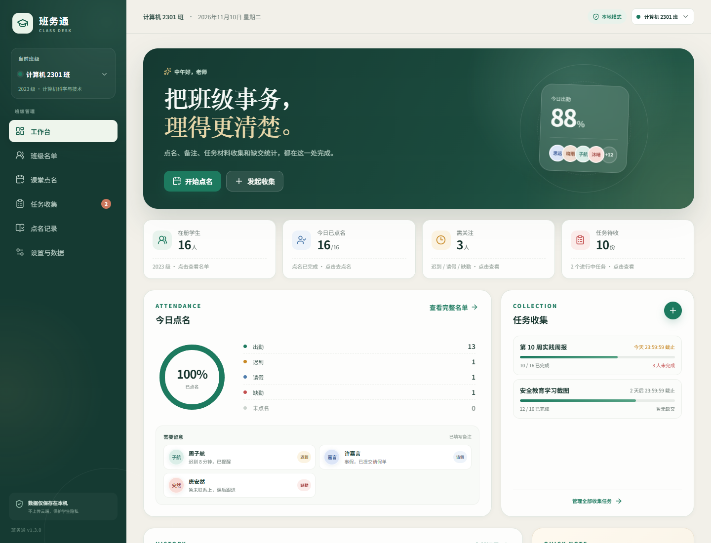
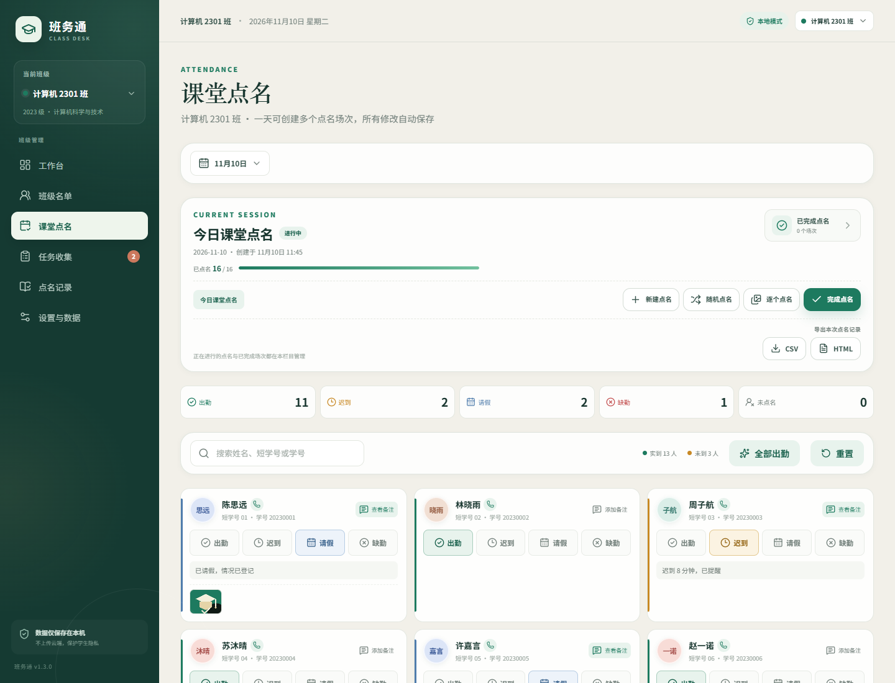
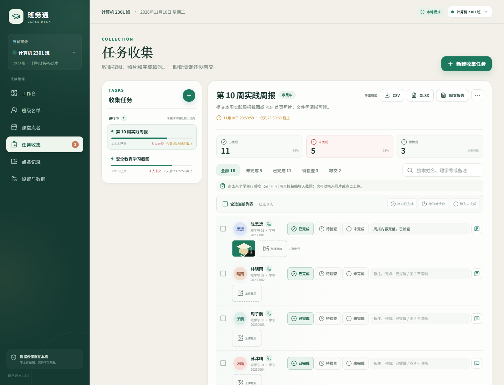
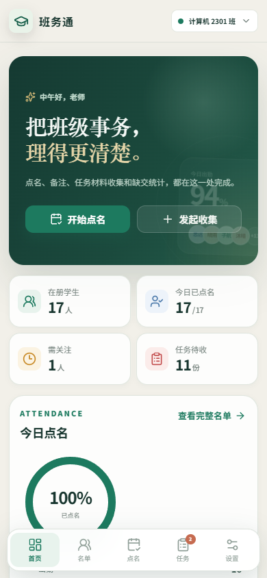
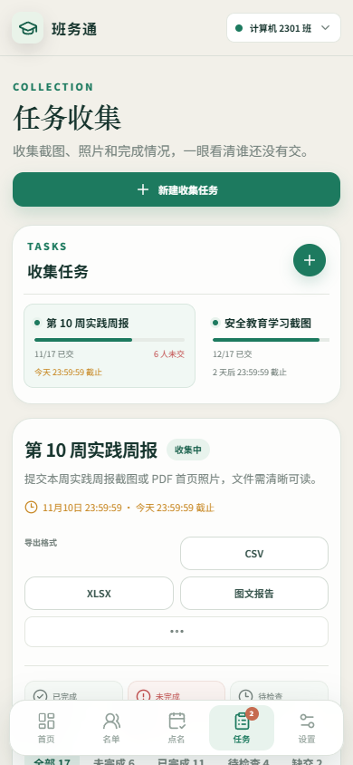
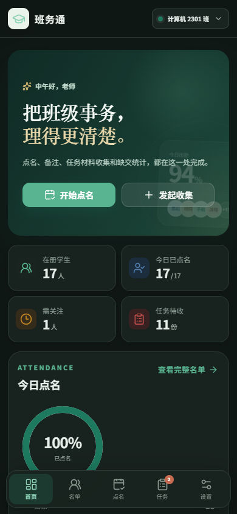
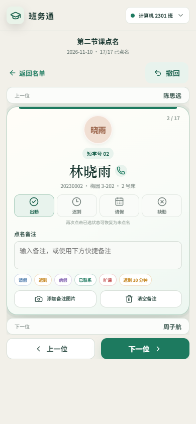

# 班务通 · Class Desk

一款**本地优先**的班级管理工具，同一套代码支持 **Windows 桌面端、Android 手机、Android 平板和浏览器 PWA**。主要用于课堂点名、学生备注、任务完成情况收集与缺交清单导出。



## 核心功能

### 课堂点名
- 一天可创建多个点名场次，并分别为每次点名设置标题。
- 支持列表点名和卡片逐个点名；卡片模式可左右滑动、前进后退并撤回修改。
- 每名学生可快速标记：出勤、迟到、请假、缺勤、未点名。
- 支持手动备注、可配置快捷备注、备注图片和一键清空备注。
- 点击已选状态可恢复为“未点名”；长按备注按钮可快速清空备注。
- 卡片点名仅在标记“出勤”时自动跳转下一位，其他状态停留在当前学生。
- 卡片点名保持整页无滚动。
- “全部出勤”、重置点名、随机点名独立弹窗、完成归档。
- 随机点名可选择未点名、已点名或全部学生，并支持出勤、迟到、请假、缺勤标记。
- 标记随机点名状态后弹窗保持打开，可继续抽取。
- 自定义日历选择日期，已完成点名与进行中场次在同一栏目管理，并可重新启动修改。
- 新建、随机、逐个、完成四个操作移动到点名标题下方。
- 出勤至未点名五个统计框改为紧凑横排。
- 已完成点名会折叠为可展开场次，支持 CSV 和 HTML 导出。
- 点名记录自动保存在本机，并可按场次导出 CSV。

### 班级名单
- 多班级独立管理。
- 添加、编辑、删除学生。
- 搜索姓名、长学号、班级短学号、宿舍和床位，按性别筛选。
- 班级短学号支持自动递增、手动修改和长学号末 4 位填充。
- Android 名单、点名和任务行均提供一键拨号按钮。
- 头像按性别使用暖色/冷色，并显示姓名最后两个字。
- CSV 批量导入和名单导出，兼容 Excel 中文编码。

### 任务收集
- 创建任务、设置说明和精确到秒的截止时间，自动为班级学生生成提交清单。
- 每名学生可标记为已完成、待检查、未完成，并支持勾选后批量设置。
- 进行中任务优先、未完成和临近截止任务靠前，已结束任务按结束时间排列。
- 导出按钮上方增加“导出格式”说明，避免与任务操作混淆。
- 支持上传照片/聊天截图，也支持在电脑端直接 `Ctrl + V` 粘贴剪贴板截图。
- 图片自动压缩，保存在本机 IndexedDB。
- “未完成”筛选和未交人数可清楚查看谁还没有提交。
- 图片预览使用全屏模态窗，可清晰放大查看并直接删除。
- 状态按钮增大，触控更容易；长按任务备注按钮可快速清空。
- 导出 CSV、XLSX 和 HTML 图文报告；XLSX 附件格内嵌图片，HTML 支持点击放大。
- HTML 报告在窄屏下使用内部横向表格滚动，不再撑破整个页面。

### 管理与其他
- 工作台四项统计卡均可点击跳转到名单、点名或任务收集。
- 最近点名与历史记录回看。
- 完整 JSON 备份，包含名单、记录、任务和图片附件。
- Android 手机深色模式、手动浅色/深色切换、状态栏安全区和键盘遮挡适配。
- 班级切换改为自绘紧凑菜单，不再使用系统原生选择框。
- Android 返回键防误触：首页需连续按两次才会退出。
- 响应式界面：Windows 三栏工作台、平板增强任务信息、手机底部导航。

## 界面预览

| 点名 | 任务收集 |
| --- | --- |
|  |  |

| 手机工作台 | 手机任务收集 |
| --- | --- |
|  |  |

| 手机深色模式 | 卡片点名 |
| --- | --- |
|  |  |

## 技术栈

- **React 19 + TypeScript + Vite**：共享前端界面和业务逻辑。
- **Zustand**：带持久化的本地状态管理。
- **IndexedDB**：保存图片和聊天截图。
- **Electron + electron-builder**：Windows 桌面安装包。
- **Capacitor 8**：Android 手机/平板原生外壳。
- **Service Worker + Web Manifest**：浏览器 PWA 安装与离线加载。

## 本地开发

环境要求：

- Node.js 22 或 24
- npm 10+
- Windows 桌面打包需要 Windows
- Android 打包需要 JDK 21、Android SDK Platform 36 和 Build Tools 36

```bash
npm ci
npm run dev
```

开发地址为 `http://127.0.0.1:5173/`。

## 构建

### Windows

```bash
npm run build:desktop
```

输出：

```text
release/Banwutong-Setup-1.3.0.exe
```

### Android

先同步最新 Web 资源：

```bash
npm run android:sync
```

构建调试 APK：

```bash
npm run android:apk
```

输出：

```text
android/app/build/outputs/apk/debug/app-debug.apk
```

也可以使用 Android Studio：

```bash
npm run android:open
```

### 浏览器 / PWA

```bash
npm run build:web
npm run preview
```

将 `dist/` 部署到任意静态站点即可作为 PWA 安装。

## 下载安装包

前往 [GitHub Releases](https://github.com/CSN8079/banwutong-class-desk/releases/latest) 下载：

- `Banwutong-Setup-1.3.0.exe`：Windows x64 安装程序
- `Banwutong-Android-1.3.0-debug.apk`：Android 调试签名 APK，可直接侧载

> 当前安装包未购买代码签名证书。Windows SmartScreen 或 Android“未知来源安装”可能提示风险，这是未签名/自签名应用的正常提示。

## 数据与隐私

- 应用无需注册账号，不连接业务服务器。
- 学生名单、点名记录、备注和图片都保存在当前设备。
- 不同设备的数据不会自动同步；请通过“设置与数据 → 导出完整备份”迁移。
- HTML 图文报告会把相关图片内嵌到导出文件，分享前请确认接收方可信。
- 卸载浏览器/应用或清理应用数据前，请先导出备份。

## 测试与质量检查

```bash
npm run lint
npm test
npm run build
```

端到端渲染与响应式检查：

```bash
npm run dev
# 另开终端
npm run test:e2e
```

覆盖桌面、390px 手机、手动深色模式、卡片点名和 768px 平板布局，并验证自定义班级菜单、日历、随机点名范围、已完成点名重启、长按清除备注、自动下一人、批量任务、XLSX/HTML 导出、HTML 窄屏适配和横向溢出检查。

## 项目结构

```text
src/
  components/       通用界面与布局
  data/             演示数据和日期工具
  lib/              CSV、导出、图片存储、文件保存
  pages/            工作台、名单、点名、任务、记录、设置
  store/            Zustand 业务状态
electron/           Electron 主进程与安全 preload
android/            Capacitor 生成的 Android 原生工程
public/             PWA 清单、Service Worker、图标
scripts/            Playwright 端到端 QA
docs/screenshots/   README 截图
resources/          Android/桌面图标源文件
```

## 路线图

- 云同步/多教师协作（需要额外后端和权限设计）
- 导入 Excel `.xlsx` 原生文件
- 更丰富的班级管理组件，如值日、座位表、活动报名
- Android 正式签名与应用商店发布

## License

MIT
